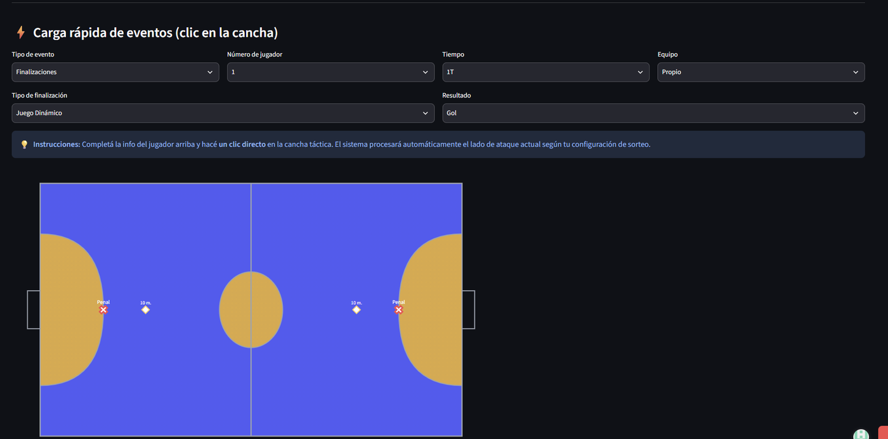
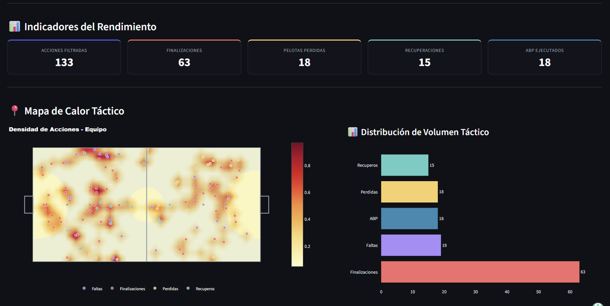
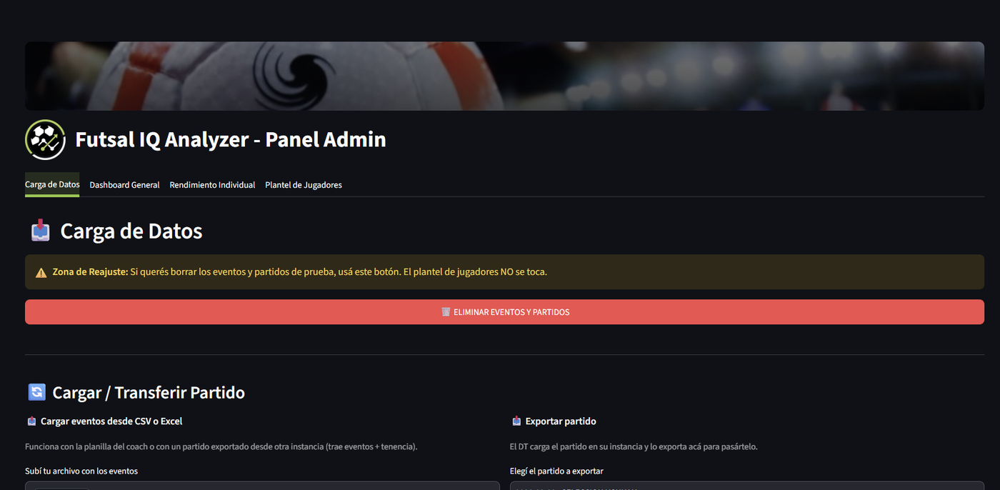
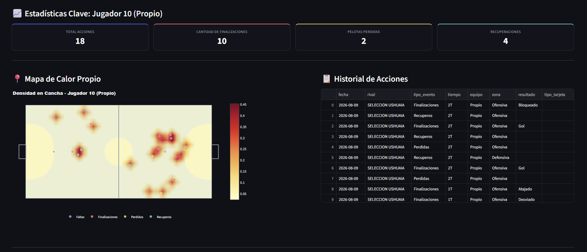

# ⚽ FutsalIQ Analyzer

Aplicación web de **análisis táctico y gestión de partidos de futsal**: el cuerpo técnico registra los eventos del partido con un clic sobre la cancha y obtiene al instante estadísticas del equipo, mapas de calor y el rendimiento individual de cada jugador.

🔗 **[Probar la app en vivo](https://futsal.streamlit.app/)**

> 🔒 **Código privado.** Este repositorio muestra la aplicación en funcionamiento. El código está disponible para revisión en entrevistas técnicas.

---

## ✨ Funcionalidades

- **Carga rápida de eventos con clic en la cancha:** tipo de evento, jugador, tiempo, equipo, tipo de finalización y resultado; el sistema ajusta el lado de ataque según el sorteo.
- **Importación y exportación de partidos** desde CSV/Excel, para pasar partidos entre instancias.
- **Dashboard general:** indicadores del rendimiento (finalizaciones, pérdidas, recuperaciones, ABP), mapa de calor de densidad sobre una cancha de 40×20 m y distribución del volumen táctico.
- **Rendimiento individual y scouting:** filtros por jugador, partido, tiempo y tipo de evento; mapa de calor propio e historial de acciones.
- **Plantel de jugadores:** alta, edición, baja y exportación a Excel.
- **Datos sintéticos** para probar la app sin datos reales.

## 🛠️ Tecnologías

Python · Streamlit · pandas · NumPy · Plotly · SQLite · Streamlit Community Cloud

---

## 📸 Capturas

| Carga de eventos con clic en la cancha | Dashboard con mapa de calor |
|---|---|
|  |  |
| **Panel de carga de datos** | **Rendimiento individual** |
|  |  |

---

## 👩‍💻 Autora

**Miriam Alicia Velazque**: diseño y desarrollo.
[LinkedIn](https://www.linkedin.com/in/miriam-alicia-velazque) · [GitHub](https://github.com/miriamvelazque)
